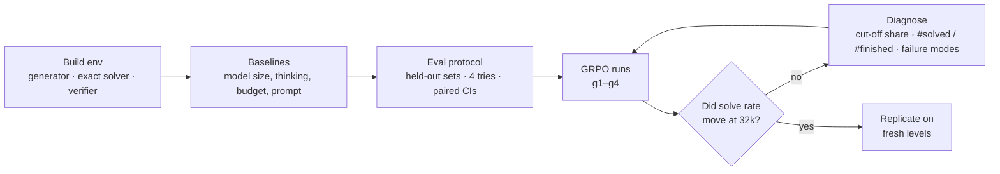
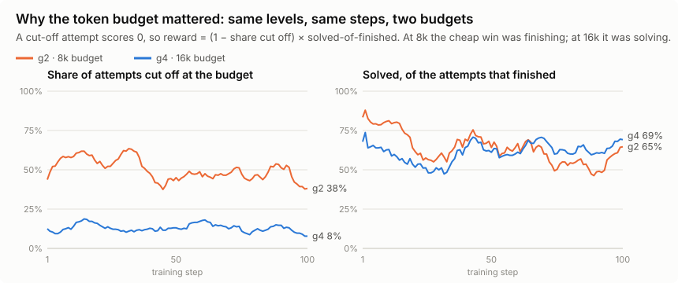
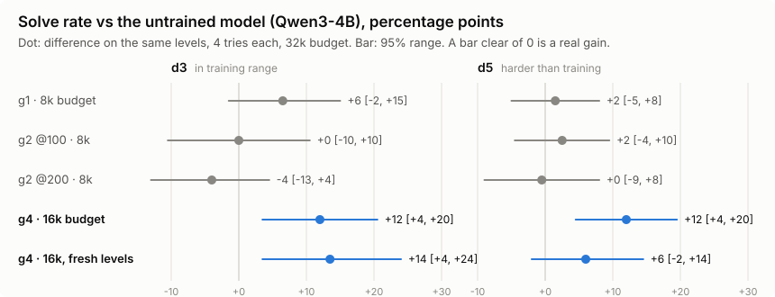

# boundgym

**Goal:** wanted to go through the motions of a rudimentary RL-for-LLM workflow. This small verifiable RL env is based around 2D grid puzzles in the style of obstacle courses such as "Frogger" - the hazards are tiles that toggle between hazardous and safe, and they behave in a predictable pattern. There are also harmless walls that cannot be occupied by the player. (The name comes from "bound" maps, a StarCraft: Brood War custom-map genre built around dodging timed hazards.)

Build the env → measure → train with GRPO → diagnose → replicate

  

Shown: Two plans running on the same level. Running straight (left): game over on hazard C at t=3. The solver's optimal plan
(right) waits once and passes between the hazard toggling off/on. So this is about timing on top of pathfinding.

## What boundgym is

- Player walks from `S` to `G` on a grid. Hazard cells (letters) are active on a fixed cycle (`t % period`). Standing on an active hazard ends the run. Moves: U/D/L/R/W (up/down/left/right/wait)
- **Every level is solvable, plus the best answer is known.** The generator keeps only levels the exact solver proves to be solvable. On difficulties d2 and above, the naive "run-straight" path must fail. From d3, the optimal route must be longer than the hazard-free shortest path, so the player has to wait or detour.
- **Verifier = Reward.** It replays the moves and returns 1 only if the player reaches `G` alive within the move limit. There's no partial credit so we knock out a lot of reward hacks.
- One difficulty knob (d1 to d8: grid size, hazard count, cycle lengths). Frozen held-out sets use seeds ≥ 1,000,000; training uses seeds from 0.
- The model sees the map and schedules as text, then answers with `<moves>…</moves>`.

## Why?

- This isn't a state-of-the-art solver. I wanted to work through the whole RL workflow on a problem small enough to verify every step:
  1. Environment correctness
  2. Eval trustworthiness
  3. Does training move the real metric, or just the training reward?
- Chapter 3's question: **Is GRPO teaching the 4B model to plan, or just change surface behaviour?**

## How the model fails

  

- Real Qwen3-4B attempts (thinking mode, d3): success, hazard death, walking into a wall, stopping one cell short, and getting cut off by the token budget.
- Base Qwen3-4B on d5: 30% hazard deaths, 26% wall bumps, 20% stopping short. **Didn't show one single dominant error type** (`chapter5/failure_taxonomy.py`).
- The individual outcomes are in [`docs/media/modes/`](docs/media/modes/) ([goal](docs/media/modes/goal.gif) · [hazard](docs/media/modes/hazard.gif) · [illegal move](docs/media/modes/illegal_move.gif) · [stopped short](docs/media/modes/did_not_reach_goal.gif) · [cut off](docs/media/modes/truncated.gif)).

## Baselines (chapter 1–2)

- "Before" curve at 32k, thinking mode (solve rate on d3 / d5): 1.7B 14% / 2%, **4B 44% / 22%**, 14B-AWQ 68% / 36% (one attempt per level; the 4-attempt protocol used from chapter 3 on gives 4B 42% / 18%). 4B sits in the useful range: it solves some levels, so there's signal, but leaves plenty of headroom for us to improve.
- Thinking matters: without it, 4B solves just 2% of d3 (vs 44% with thinking at 32k). So does the budget: at 8k with thinking, 60% of d3 attempts are cut off (leading to solve rate 18%).
- A per-step hazard timeline in the prompt didn't beat the modulo rule (ch 2).
- Practical learning: don't neglect the scorer. A parser bug was rejecting correct answers (up to 8 pts per set) until it was caught. The saved outputs were then re-scored.

## Training: what worked and what didn't (chapter 3)

  

- Setup: TRL GRPO, LoRA r=32, colocated vLLM, strict 0/1 reward, 4 levels × 8 attempts per step, on an RTX 5090.
- | run | change | outcome |
  |---|---|---|
  | g1, g2 | 8k budget | ~20% shorter answers, **no accuracy gain** |
  | g3 | LR 5e-5 | collapsed: longer, more random output |
  | g4 | **16k budget** | **observed accuracy gain** |
- **Key finding: token budget decides learnings from reward:** reward = (1 − share cut off) × solved-of-finished.
  - At 8k, ~55% of attempts were cut off, so the easiest gain was just finishing sooner.
  - At 16k, ~12% were cut off. So the gain had to come from solving (the right panel above).
- Reading training curves?
  - Viewing training reward graph alone: misleading
  - All runs see the same levels in the same order, so compare runs at the same step, not a run against its own start.

## Test Result

  

- **Keep unused levels for unbiased testing.** g4 was picked as the winner on the original sets, which inflates those numbers. The fresh/unused set (seeds 2,000,000+) was generated afterwards.
- On fresh levels:
  - **d3: +14 pts [+3, +24]**, a clear gain (40% → 53%).
  - **d5: +6 [−2, +14]**, pointing the right way, but not significant enough alone.
  - Pooled with the originals: d3 +12.8 [+6.2, +19.2], d5 +9.0 [+3.2, +14.5].
- tl;dr **a clear gain at training-level difficulty, with a likely but smaller transfer to harder levels.**
- Answers got slightly *shorter*, so this isn't just the model thinking longer. The gain is mostly fewer wall bumps (better position tracking), followed by fewer hazard deaths.
- Limits:
  - One run per configuration
  - One model size
  - 100 steps (This alone being ~14 hours on one GPU...)

## Practical things
##### These may not always carry over, but I'll recall encountering these
- Use a budget at which most attempts finish (watch the cut-off% next to training reward)
  - During training: track "solved among finished", not just the reward
- Given a fixed data order, compare runs at the same step
- Replicate the first significant result on new data, generated only after picking the winning checkpoint (g4 was picked for scoring best on the original levels, and part of that lead can be luck; levels made afterwards played no part in picking the winning checkpoint, so they'll give an honest score)
- Make checkpoints resumable from day one: a 100-step run took ~14 hours and was paused twice
- More: [notes/lessons.md](notes/lessons.md)

## Progress dashboard

  

- A local, low-cost/dep-free status page (`scripts/dashboard.py`). It shows:
  - chapters of work, status, todo
  - live training runs with pacing, ETA, and the three training charts
  - evals with paired CIs
- Used to keep a multi-day, frequently paused project resumable (in workflow and in mental state). [docs/dashboard.md](docs/dashboard.md)

## Quick start

- `git lfs install` before cloning: eval results and media are in Git LFS.
- `pip install -e ".[dev]"`, then `pytest -q`.
- Freeze held-out level sets: `python scripts/make_levels.py`; non-LLM baselines: `python scripts/baselines.py`.
- Evaluate a model served by vLLM: `scripts/eval_openai.py` (see `chapter1/README.md`).
- Train: `chapter3/train_grpo.py` (needs the vLLM venv; see `notes/environment.md`). Evaluate a checkpoint: `chapter3/eval_ckpt.sh`.
- Regenerate the README figures: `.venv/bin/python scripts/make_readme_figures.py`. Regenerate the demo animations: `python scripts/make_demo.py` (writes `.gif`, plus `.mp4` and `.webm` with the same timing, to `docs/media/`).

## Repository map

- `boundgym/`: the environment (level, generate, solve, verify, render, env, trl_hooks).
- `chapter1/`, `chapter2/`, `chapter3/`, `chapter5/`: experiments and their results; `chapter3/WRITEUP.md` is the chapter 3 story. Readability note: Other .md files in the repo contain autogenerated reports.
- `notes/`: results, findings, lessons, issues, changes. [`progress.md`](progress.md) is the hub for the project's work state; [`todo.md`](todo.md) is the task list. These were logged by the agent as it ran the project (see below).
- Full tree: [notes/architecture.md](notes/architecture.md)

## How this was built

- The project started in a Claude project session on claude.ai, where the chapter 1 kit (environment, exact solver, verifier, eval script) was written. It then moved to local development, with Claude Code as the agent running the experiments on my machine.
- The notes (`progress.md`, `todo.md`, `notes/*.md`, the run READMEs) were logged by the agent as it ran the project, which is why some of them are written in its voice.

## Next Steps

- A per-tick scratchpad, where the model writes the tick, its position, and hazard states each move. It aims at the remaining timing and position errors, and could be screened by prompting alone
- Ch 4: rollout speed (FP8 KV cache, fused loss, 2-GPU server mode)
- Ch 5: look inside the model: probes for position and tick
- Ch 6: Review findings
